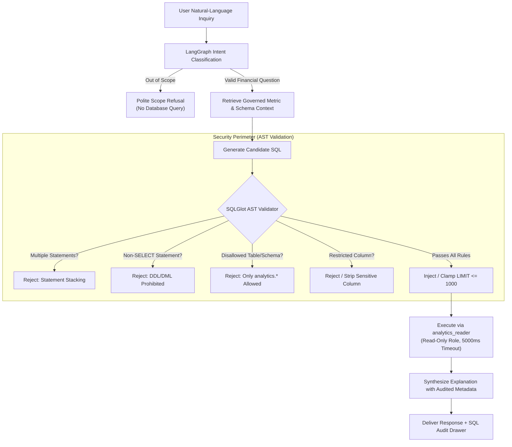

# Enterprise AI Analytics Platform for Financial Services

[](https://github.com/mrsimiloluwa/test/actions/workflows/ci.yml)
[](https://www.python.org/downloads/release/python-3120/)
[](https://github.com/astral-sh/uv)
[](https://github.com/astral-sh/ruff)
[](https://www.getdbt.com/)
[](https://fastapi.tiangolo.com/)
[](https://streamlit.io/)

A modular financial analytics and governed AI platform demonstrating production-quality software engineering, data engineering, analytics engineering, and responsible AI practices.

The platform bridges **deterministic analytics engineering** (dbt Core, dimensional Kimball star schemas, double-entry accounting models in PostgreSQL and DuckDB) with **controlled natural-language AI workflows** (LangGraph state graphs, Abstract Syntax Tree SQL parsing with SQLGlot, and semantic metric catalogs).

---

## Table of Contents

- [1. Explain: Financial Domain & System Architecture](#1-explain-financial-domain--system-architecture)
  - [1.1 The Business Problem in Financial Services](#11-the-business-problem-in-financial-services)
  - [1.2 The Accounting Bridge: Deterministic Financial Integrity](#12-the-accounting-bridge-deterministic-financial-integrity)
  - [1.3 System Architecture](#13-system-architecture)
  - [1.4 Technology Stack](#14-technology-stack)
- [2. Teach: Core Concepts & Responsible AI](#2-teach-core-concepts--responsible-ai)
  - [2.1 Dimensional Modeling vs. Flat Data](#21-dimensional-modeling-vs-flat-data)
  - [2.2 Governed Metrics vs. "Prompt-Engineered SQL"](#22-governed-metrics-vs-prompt-engineered-sql)
  - [2.3 Responsible AI in Financial Services](#23-responsible-ai-in-financial-services)
  - [2.4 AST-Level SQL Validation & Sandboxing](#24-ast-level-sql-validation--sandboxing)
  - [2.5 Deterministic Mock vs. Live LLM Providers](#25-deterministic-mock-vs-live-llm-providers)
  - [2.6 Human Oversight, Data Privacy & Limitations](#26-human-oversight-data-privacy--limitations)
- [3. Use: Exploring & Running the Platform](#3-use-exploring--running-the-platform)
  - [3.1 Navigating the Executive Dashboard](#31-navigating-the-executive-dashboard)
  - [3.2 Quickstart: Running Locally](#32-quickstart-running-locally)
  - [3.3 Running with Docker Compose](#33-running-with-docker-compose)
  - [3.4 Apache Airflow Pipeline Orchestration](#34-apache-airflow-pipeline-orchestration)
  - [3.5 Running Tests & Code Quality Verification](#35-running-tests--code-quality-verification)
- [4. Repository Structure & Engineering Principles](#4-repository-structure--engineering-principles)
  - [4.1 Repository Layout](#41-repository-layout)
  - [4.2 Core Engineering Principles](#42-core-engineering-principles)
  - [4.3 In-Depth Documentation Links](#43-in-depth-documentation-links)

---

## 1. Explain: Financial Domain & System Architecture

### 1.1 The Business Problem in Financial Services

Commercial banks, payment processors, and financial institutions face complex analytical challenges when managing fee schedules, customer relationships, and operational revenue:

1. **Fee Variance & Revenue Leakage**: Financial institutions assess transaction fees, interchange rates, wire charges, and account servicing costs across millions of transactions. Without rigorous modeling, discrepancies between contractual fee schedules and actual charged amounts go undetected.
2. **Waivers, Concessions & Arrears**: Relationship managers frequently grant discretionary fee waivers to high-value clients, while accounts with insufficient balances fall into billing arrears. Understanding true revenue requires tracking not just what was assessed, but what was waived, what remains unpaid, and what was collected.
3. **The Risk of LLM Hallucination in Finance**: Business leaders want to ask natural-language questions like *"What was our net recognized revenue last month?"* or *"Which institutional clients have the highest outstanding arrears?"*. However, standard Large Language Models (LLMs) hallucinate arithmetic, misinterpret ambiguous database column names, and invent non-compliant SQL queries when connected directly to raw relational tables.

This platform demonstrates how to solve these problems by using a **governed semantic layer** where metrics are formally defined, verified, and audited before any AI or user query can execute.

### 1.2 The Accounting Bridge: Deterministic Financial Integrity

Monetary calculations must never rely on probabilistic models or IEEE-754 floating-point arithmetic. All monetary values across this platform are stored and calculated using exact fixed-point `DECIMAL(18, 4)` / `NUMERIC` types.

The core financial engine enforces a strict **Accounting Bridge** reconciling every fee assessment to net recognized revenue down to the cent:

$$\begin{aligned}
\text{Gross Assessed Fees} & \quad \mathbf{€467,449.70} \\
- \text{Discretionary Fee Waivers} & \quad - \mathbf{€8,061.56} \\
\hline
= \text{Net Collectible Fee Pool} & \quad \mathbf{€459,388.14} \\
- \text{Uncollected Billing Arrears} & \quad - \mathbf{€29,280.10} \\
\hline
= \text{Cash Collected Sweeps} & \quad \mathbf{€430,108.04} \\
- \text{Fee Reversals & Refunds} & \quad - \mathbf{€0.00} \\
- \text{Pass-Through Clearing Costs} & \quad - \mathbf{€21,505.40} \\
\hline
= \mathbf{Net\ Recognized\ Revenue} & \quad \mathbf{€408,602.64}
\end{aligned}$$

Every transaction, fee assessment, and journal entry in the demonstration dataset reconciles to this authoritative formula.

### 1.3 System Architecture

The platform separates responsibilities across five distinct architectural tiers:

```mermaid
flowchart TD
    subgraph Presentation["1. Presentation Tier"]
        UI["Streamlit Executive Dashboard<br/>(Overview, Rankings, Arrears, Copilot, Catalog)"]
    end

    subgraph Application["2. Application & API Tier"]
        API["FastAPI REST & Telemetry Service<br/>(API Key Auth, Rate Limiting, OpenAPI)"]
        MCP["Model Context Protocol (MCP) Server<br/>(Governed Tool Interfaces)"]
    end

    subgraph AI["3. AI Orchestration & Security Perimeter"]
        LG["LangGraph Directed State Machine<br/>(8 Specialized Nodes: Intent, Context, Generation, Validation)"]
        VAL["SQLGlot AST Safety Validator<br/>(SELECT Only, Schema Allowlist, Limit Clamping)"]
        RAG["Financial Policy & Catalog RAG<br/>(Fee Schedules, Metric Definitions)"]
    end

    subgraph Governance["4. Metadata & Governance Tier"]
        CAT["dbt Compilation Artifacts & Lineage<br/>(manifest.json, catalog.json, run_results.json)"]
        MET["12 Certified Financial Metrics<br/>(financial_metrics.yaml & PostgreSQL metadata schema)"]
    end

    subgraph Storage["5. Warehouse & Orchestration Tier"]
        DB["PostgreSQL 16 / DuckDB<br/>(analytics schema: 9 Kimball Marts)"]
        AIR["Apache Airflow 2.10.3<br/>(Daily Ingestion, dbt Build & Reconciliation DAGs)"]
    end

    UI -->|HTTP / JSON| API
    API --> LG
    MCP --> LG
    LG --> RAG
    LG --> VAL
    VAL -->|analytics_reader (Read-Only)| DB
    CAT --> MET
    MET --> LG
    AIR -->|Orchestrates| DB
    DB -.->|Metadata Export| CAT
```

1. **Presentation Tier**: An interactive Streamlit application structured into five business workspaces.
2. **Application & API Tier**: A typed FastAPI backend with API key authentication, sliding-window rate limiting, and standard OpenAPI documentation.
3. **AI Orchestration & Security Perimeter**: A stateful LangGraph workflow that retrieves schema context, generates SQL, validates the Abstract Syntax Tree (AST), and synthesizes audited explanations.
4. **Metadata & Governance Tier**: Automated extraction of dbt compilation artifacts, columnar data classifications, dependency lineage, and 12 certified financial metrics.
5. **Warehouse & Orchestration Tier**: Dual storage engines (PostgreSQL 16 for Docker/production and DuckDB for lightweight zero-dependency deployment) orchestrated by Apache Airflow.

### 1.4 Technology Stack

| Layer | Technology | Architectural Role |
| :--- | :--- | :--- |
| **Language & Environment** | Python 3.12 + `uv` | Modern Python runtime with reproducible, high-performance dependency locking. |
| **Analytical Warehouse** | PostgreSQL 16 & DuckDB | PostgreSQL for production relational warehousing; DuckDB for embedded, zero-infrastructure analytical execution. |
| **Analytics Engineering** | dbt Core (`dbt-postgres`) | Kimball dimensional modeling, automated schema migrations, data testing, and documentation. |
| **Data Orchestration** | Apache Airflow 2.10.3 | Automated daily ELT pipelines with isolated execution and reconciliation DAGs. |
| **API & Data Product** | FastAPI + Pydantic v2 | High-throughput, typed REST endpoints with structured JSON schemas and rate limiting. |
| **AI Orchestration** | LangGraph + SQLGlot | State machine managing the question-answering lifecycle with AST SQL validation. |
| **User Interface** | Streamlit | Executive financial analytics dashboard and conversational Copilot. |
| **Testing & Quality** | pytest + Ruff + MkDocs | Comprehensive automated test suite, fast static linting, and strict documentation validation. |

---

## 2. Teach: Core Concepts & Responsible AI

### 2.1 Dimensional Modeling vs. Flat Data

In financial systems, running queries directly against raw transactional tables or flat CSV files leads to severe data quality issues:
- **Double-Counting**: Joining transactions directly to account balances duplicates balance amounts across multiple transactions.
- **Grain Confusion**: Comparing daily fee assessments against monthly revenue recognition entries produces misleading aggregates.
- **Performance Degradation**: Scanning raw transactional tables for high-level customer trends consumes unnecessary computing resources.

This platform implements **Kimball dimensional modeling** in dbt Core, organizing data into nine clean analytical marts in the `analytics` schema:

| Mart Name | Type | Grain | Key Metrics / Attributes |
| :--- | :--- | :--- | :--- |
| `dim_customers` | Dimension | One record per customer | Segment (`INSTITUTIONAL`, `COMMERCIAL_SME`, `CORPORATE`), risk score, onboarding date. |
| `dim_accounts` | Dimension | One record per account | Account type, currency, customer key, operational status. |
| `dim_gl_accounts` | Dimension | One record per GL account | Chart of accounts code (GL 1000–5000), account classification, currency. |
| `fct_transactions` | Fact | One record per transaction | Gross amount, transaction fee, scheme fee, currency conversion rates, timestamps. |
| `fct_fee_assessments` | Fact | One record per fee assessment | Assessed fee, waiver amount, collected amount, arrears balance, collection attempts. |
| `fct_daily_balances` | Fact | One record per account per day | End-of-day ledger balance, available balance, daily accrued interest. |
| `fct_general_ledger_entries` | Fact | One record per journal debit/credit | Balanced double-entry postings, debit/credit flags, posting timestamps. |
| `fct_revenue_recognition` | Fact | One record per revenue recognition | Recognized net revenue, amortization period, fee category. |
| `agg_customer_profitability` | Aggregate Mart | One record per customer per month | Aggregated fees, waivers, pass-through costs, net revenue, and margin percentages. |

### 2.2 Governed Metrics vs. "Prompt-Engineered SQL"

A common architectural flaw in text-to-SQL prototypes is passing a database schema to an LLM and asking it to write ad-hoc SQL calculations. When asked for *"Net Revenue"*, one prompt might calculate `SUM(gross_fee) - SUM(waiver)`, while another might calculate `SUM(cash_collected)`, leading to inconsistent figures and broken trust.

In this platform, metrics are **centrally governed and cataloged**:
- Every metric has an immutable identifier, formula, grain, and currency rule declared in `packages/data_platform/src/data_platform/metadata/financial_metrics.yaml`.
- The catalog exposes **12 certified metrics** (e.g., `net_recognized_revenue_eur`, `gross_assessed_fees_eur`, `fee_waiver_rate_pct`, `uncollected_arrears_eur`).
- The AI Copilot is restricted to using these authoritative formulas rather than inventing its own mathematical definitions.

### 2.3 Responsible AI in Financial Services



Applying AI to financial data requires strict boundaries. Large Language Models are probabilistic text generators: they can hallucinate plausible-looking numbers, confuse currencies, or misstate accounting totals.

This repository enforces five foundational responsible AI practices:

1. **LLMs are Translators, Not Calculators**: The language model is never trusted to perform mathematical operations or calculate business metrics. Its role is solely to translate natural-language inquiries into structured database queries or catalog lookups. The arithmetic is executed deterministically by PostgreSQL or DuckDB.
2. **Compile-Time AST SQL Validation**: No AI-generated SQL query reaches the database without first passing through an Abstract Syntax Tree (AST) validator.
3. **Least-Privilege Database Sandboxing**: Queries run under a restricted, read-only database role (`analytics_reader`) with hard execution timeouts.
4. **Transparent Auditability**: Every AI response includes an interactive inspection drawer displaying the sanitized SQL, execution latency, and queried dimensional mart.
5. **Deterministic Testing & Reproducibility**: The evaluation suite tests 32 curated financial benchmark inquiries, verifying 100% accuracy and 100% prompt injection resistance.

### 2.4 AST-Level SQL Validation & Sandboxing

The platform's [`SQLGlotASTValidator`](file:///Users/soremekuns/test/packages/ai_services/src/ai_services/security/sql_validator.py) inspects the parsed Abstract Syntax Tree of every candidate query. Simple regex filters can be bypassed with comments, whitespace, or nested statements; AST validation evaluates the true structural meaning of the SQL statement:

- **Single Statement Enforcement**: Rejects semicolons or multiple AST expressions, eliminating statement stacking attacks (`SELECT ...; DROP TABLE ...`).
- **Read-Only Verification**: Rejects any non-`SELECT` command (`INSERT`, `UPDATE`, `DELETE`, `DROP`, `ALTER`, `CREATE`, `TRUNCATE`, `GRANT`).
- **Schema & Table Allowlist**: Queries are restricted exclusively to the nine approved tables in the `analytics` schema (`analytics.dim_*`, `analytics.fct_*`, `analytics.agg_*`). Any attempt to query raw ingestion tables (`raw.*`), staging models (`staging.*`), or internal Airflow metadata tables raises an immediate validation rejection.
- **Column Classification & Stripping**: Columns tagged as `RESTRICTED` or containing sensitive identifiers are automatically removed or rejected before execution.
- **Row Limit Injection & Clamping**: Queries missing a `LIMIT` clause are automatically appended with `LIMIT 1000`. User-specified smaller limits (such as `LIMIT 10`) are preserved, while requests for excessive row counts are clamped to 1,000 to prevent denial-of-service memory exhaustion.
- **Prohibited Functions**: Rejects dangerous database functions, including file access (`pg_read_file`), system evaluation, or external network connections.
- **Physical Database Sandboxing**: Validated queries execute in PostgreSQL under the dedicated `analytics_reader` role with read-only grants and a strict `statement_timeout = 5000` (5 seconds).

### 2.5 Deterministic Mock vs. Live LLM Providers

To ensure accessibility, continuous testing, and zero-cost local exploration, the platform includes two swappable LLM provider implementations:

```
                          ┌─────────────────────────────────────┐
                          │         LLM Provider Router         │
                          └──────────────────┬──────────────────┘
                                             │
                    ┌────────────────────────┴────────────────────────┐
                    │                                                 │
     ┌──────────────▼──────────────┐                   ┌──────────────▼──────────────┐
     │ DeterministicMockLLMProvider│                   │  OpenAICompatibleProvider   │
     ├─────────────────────────────┤                   ├─────────────────────────────┤
     │ • 100% offline & zero-cost  │                   │ • Remote LLM API via HTTPS  │
     │ • Deterministic routing     │                   │ • Configurable base URL     │
     │ • Verified SQL benchmarks   │                   │ • Bearer token auth         │
     │ • Ideal for CI & testing    │                   │ • Automatic mock fallback   │
     └─────────────────────────────┘                   └─────────────────────────────┘
```

- **`DeterministicMockLLMProvider`**:
  - Requires no API keys, runs 100% offline, and incurs zero token costs.
  - Maps natural-language questions and entity count inquiries (*"How many customers do we have?"*, *"What was our net recognized revenue?"*) directly to verified, governed SQL benchmarks.
  - Returns identical, reproducible answers for continuous integration and automated testing.
- **`OpenAICompatibleProvider`**:
  - Connects to any standard OpenAI-compatible API endpoint (OpenAI, Gemini, Mistral, Ollama, vLLM) via `LLM_BASE_URL` and `LLM_API_KEY`.
  - Implements runtime secret masking to ensure API keys never leak into logs or telemetry traces.
  - Automatically falls back to the deterministic mock provider if the remote service is unavailable.
- **Transparent User Interface Badging**:
  - The Streamlit interface displays an explicit badge on every response card: `🧪 Demo Mode: Deterministic Mock Provider` or `🟢 Live LLM`. Users always know whether an answer originated from deterministic routing or a live model.

### 2.6 Human Oversight, Data Privacy & Limitations

Responsible AI requires transparency regarding what a platform can and cannot do:

- **Human Oversight**: The platform is an analytical decision-support tool, not an autonomous transactional actor. It generates reports, analyzes margins, and highlights arrears; it does not originate wires, alter ledger balances, or modify fee structures.
- **Data Privacy**: All data in this repository is **100% synthetic**. Customer names, account numbers, transactions, and amounts were procedurally generated using Python and Faker with statistical distributions. No actual customer, employee, or bank proprietary data is present.
- **Operational Limitations**:
  - The demonstration models fee analytics and revenue recognition for commercial transaction banking. It is not a complete general ledger or core banking deposit engine.
  - It does not process real-time payment network rails (SEPA, Fedwire, SWIFT).
  - The AI Copilot is strictly scoped to financial analytics; inquiries outside commercial banking (e.g., code generation or general web queries) are politely declined.

---

## 3. Use: Exploring & Running the Platform

### 3.1 Navigating the Executive Dashboard

The Streamlit dashboard provides five specialized workspaces designed for financial analysts, business users, and data professionals:

```
┌────────────────────────────────────────────────────────────────────────────────────────┐
│  🏦 Financial Services Analytics Platform                                              │
│  [ Workspace: Executive Overview | Customer Rankings | Arrears | AI Copilot | Catalog ]│
├────────────────────────────────────────────────────────────────────────────────────────┤
│  KPI Cards:                                                                            │
│  [ Net Revenue: €408,602.64 ]  [ Assessed Fees: €467,449.70 ]  [ Arrears: €29,280.10 ] │
├────────────────────────────────────────────────────────────────────────────────────────┤
│  Reconciled Revenue Accounting Bridge:                                                 │
│  Gross Fees (€467.4k) ──> Waivers (-€8.1k) ──> Arrears (-€29.3k) ──> Net (€408.6k)    │
└────────────────────────────────────────────────────────────────────────────────────────┘
```

1. **Executive Overview**: High-level financial KPIs (Net Recognized Revenue, Gross Assessed Fees, Fee Waivers, Uncollected Arrears, and Exception Rate) alongside the visual accounting bridge waterfall and multi-month revenue trends.
2. **Customer Rankings**: Customer profitability leaderboard filterable by segment (`INSTITUTIONAL`, `COMMERCIAL_SME`, `CORPORATE`) with net revenue totals, direct operating costs, and realized fee margins.
3. **Billing Arrears**: Itemized registry of customers with outstanding unpaid fees, categorized by aging buckets (0–30, 31–60, 61–90, and 90+ days in arrears) to support cash collection workflows.
4. **AI Financial Copilot**: Conversational interface supporting natural-language inquiries (e.g., *"What was our net recognized revenue?"*, *"How many customers do we have?"*, *"Show me customers in arrears"*). Every response includes:
   - A business summary and key metric highlight.
   - A data table with a 1-click **Download CSV** button.
   - An expandable **Governed SQL & Execution Audit** drawer showing the sanitized SQL, execution role (`analytics_reader`), queried dimensional mart, and query execution latency.
5. **Governed Metric Catalog**: Interactive reference listing all 12 certified metrics with their formal business descriptions, mathematical formulas, grain, and source dbt models.

### 3.2 Quickstart: Running Locally

#### Prerequisites
- macOS (Apple Silicon compatible, optimized for 16GB RAM) or Linux
- Python 3.12
- [uv](https://docs.astral.sh/uv/) (recommended for dependency management) or standard `pip`
- Docker Desktop (optional, required only for containerized PostgreSQL and Airflow)

#### Installation

1. **Clone the repository:**
   ```bash
   git clone https://github.com/mrsimiloluwa/test.git
   cd test
   ```

2. **Configure environment variables:**
   ```bash
   cp .env.example .env
   ```

3. **Install dependencies with `uv`:**
   ```bash
   uv sync --all-groups
   ```

#### Option A: Standalone DuckDB Mode (Instant Exploration)

The fastest way to explore the platform without starting Docker or configuring PostgreSQL. The application automatically detects that no local PostgreSQL instance is running on port 5432 and initializes embedded DuckDB analytical marts:

```bash
# Launch the Streamlit dashboard in standalone embedded mode
.venv/bin/streamlit run packages/data_apps/src/data_apps/app.py
```
Open **http://localhost:8501** in your browser. All five workspaces and the AI Financial Copilot operate immediately with full query capability.

---

### 3.3 Running with Docker Compose

To run the complete platform including PostgreSQL 16, the FastAPI backend, and the Streamlit dashboard:

```bash
# 1. Start PostgreSQL, FastAPI, and Streamlit in the background
docker compose up -d postgres api dashboard

# 2. Verify running containers
docker compose ps

# 3. Access web interfaces:
# - Streamlit Executive Dashboard: http://localhost:8501
# - FastAPI Interactive Swagger Docs: http://localhost:8000/docs
# - API Health Endpoint: http://localhost:8000/health

# 4. Stop containers when finished:
docker compose down
```

---

### 3.4 Apache Airflow Pipeline Orchestration

For automated data pipeline execution, the repository includes an Apache Airflow 2.10.3 stack configured with `LocalExecutor`:

```bash
# 1. Initialize Airflow metadata database and admin credentials
docker compose up airflow-init

# 2. Start Airflow Webserver and Scheduler
docker compose up -d airflow-webserver airflow-scheduler

# 3. Access Airflow Web UI at http://127.0.0.1:8080 (User: admin / Password: admin)

# 4. Trigger the daily financial analytics ELT pipeline
docker compose exec airflow-webserver airflow dags trigger financial_analytics_dev_pipeline

# 5. Trigger the automated test pipeline
docker compose exec airflow-webserver airflow dags trigger financial_analytics_test_pipeline
```

---

### 3.5 Running Tests & Code Quality Verification

All tests, linters, and documentation builds run deterministically:

```bash
# Run Ruff linting across all packages
.venv/bin/ruff check .

# Check code formatting
.venv/bin/ruff format --check .

# Run complete pytest test suite (166+ unit and integration tests)
.venv/bin/pytest tests/unit/ -v

# Run AI security and evaluation benchmarks
.venv/bin/pytest tests/unit/test_ai_sql_validator.py tests/unit/test_ai_graph.py -v

# Validate documentation build with strict link checking
.venv/bin/mkdocs build --strict

# Inspect API telemetry and request metrics
curl -s http://127.0.0.1:8000/telemetry | jq .
```

---

## 4. Repository Structure & Engineering Principles

### 4.1 Repository Layout

The repository is organized as a clean Python monorepo with clear separation between data engineering, analytics engineering, AI services, and user applications:

```
.
├── .github/
│   └── workflows/ci.yml       # GitHub Actions CI pipeline (lint, test, build)
├── airflow/                   # Apache Airflow orchestration
│   ├── dags/                  # Daily ingestion and reconciliation DAGs
│   └── docker-compose.yml     # Containerized Airflow services
├── docs/                      # Architectural Decision Records (ADRs) & guides
│   ├── architecture/          # System design, SQL security, and ingestion architecture
│   ├── portfolio/             # Architecture walkthrough and deep-dive guide
│   ├── runbooks/              # Setup, operations, and production deployment runbooks
│   └── technical/             # dbt model references, metric catalog, and AI evaluation
├── packages/
│   ├── shared/                # Centralized database configuration, logging & models
│   ├── data_platform/         # Ingestion engine, dbt project, and metadata catalogs
│   │   ├── dbt_analytics/     # 26 dbt models (staging, intermediate, marts)
│   │   └── src/data_platform/ # Synthetic data generation & metadata CLI
│   ├── ai_services/           # LangGraph workflow, SQLGlot AST validator & providers
│   └── data_apps/             # Streamlit executive dashboard & Copilot UI
├── sample_data/               # Publicly inspectable CSV extracts of synthetic entities
├── tests/
│   ├── airflow/               # Airflow DAG validity and DagBag tests
│   ├── unit/                  # Fast unit tests (DuckDB, AST validator, config)
│   └── integration/           # Database and API integration test suite
├── docker-compose.yml         # Root multi-container Compose runner
├── mkdocs.yml                 # MkDocs documentation site configuration
├── pyproject.toml             # Project manifest & tool configurations
└── README.md                  # This file
```

### 4.2 Core Engineering Principles

This repository strictly adheres to the engineering standards defined in [`AGENTS.md`](file:///Users/soremekuns/test/AGENTS.md):

1. **Separation of Concerns**: Business transformations reside in dbt dimensional models; infrastructure logic resides in configuration and Docker Compose; user presentation resides in Streamlit; AI orchestration resides in LangGraph.
2. **Deterministic Financial Precision**: Authoritative financial calculations must never use IEEE-754 floating-point numbers. Monetary values are strictly typed as `DECIMAL(18, 4)` / `NUMERIC`.
3. **Defense in Depth**: AI text-to-SQL generation is treated as a security boundary. Queries must pass Abstract Syntax Tree validation and execute under least-privilege, read-only database credentials with hard statement timeouts.
4. **Reproducible Synthetic Data**: All banking entities, transactions, fee assessments, and general ledger journals are synthetic and reproducible using documented generation seeds.
5. **Inspectable Engineering Artifacts**: SQL transformations, DDL statements, API schemas, and test outputs are explicitly committed and documented rather than obscured inside application code.

### 4.3 In-Depth Documentation Links

For deeper technical exploration, consult the dedicated documentation sections:

- [System Architecture & Exploration Walkthrough](docs/portfolio/walkthrough.md): Comprehensive system guide covering architecture flows, financial formulas, and trade-offs.
- [SQL Security & AST Boundary Defense](docs/architecture/sql-security.md): Detailed specification of the SQLGlot AST validator, allowed schemas, and security testing.
- [Governed Financial Metric Registry](docs/technical/analytics/metric-catalogue.md): Complete catalog of the 12 certified financial metrics, formulas, and grains.
- [dbt Analytical Model Reference](docs/technical/analytics/dbt-model-reference.md): Technical breakdown of the 26 dimensional marts, staging models, and data tests.
- [LLM Integration & Provider Architecture](docs/technical/ai/llm-integration.md): Architecture of the swappable LLM providers, secret masking, and fallback mechanisms.
- [Production Deployment Runbook](docs/runbooks/deployment.md): Operational guide for Docker Compose, Streamlit Community Cloud, Railway, and VPS deployments.
- [Local Setup & Operations Runbook](docs/runbooks/setup.md): Step-by-step developer setup and troubleshooting guide.
