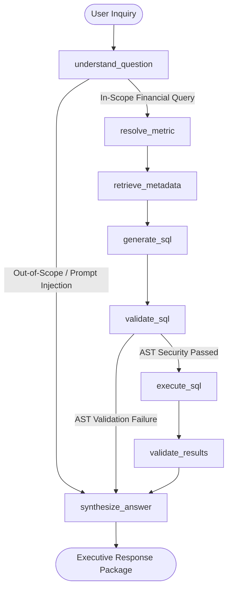

# AI Analytics Architecture — LangGraph & Governed Q&A

## 1. Executive Summary

The AI Financial Analytics engine in `packages/ai_services` implements a controlled, stateful question-answering workflow powered by **LangGraph**. It translates natural language financial inquiries from commercial banking leadership into audited, read-only SQL queries executed against certified PostgreSQL dimensional warehouse marts.

Unlike naive text-to-SQL agents that query raw schemas or hallucinatively formulate ad-hoc calculations, this architecture enforces:

1. **Strict Metadata Resolution**: All questions map to pre-approved metrics from `MetadataService` and formulas defined in the governed data catalog.
2. **Deterministic AST Validation**: Generated SQL is parsed and inspected via **SQLGlot** before reaching the database, rejecting non-SELECT commands, unapproved schemas, and sensitive columns.
3. **Database-Level Least Privilege**: Query execution occurs strictly under a dedicated PostgreSQL role `analytics_reader` with SELECT-only grants on schema `analytics` and a 5,000ms statement timeout.
4. **Transparent Evidence**: Responses package the executive narrative together with raw records, tabular projections, reporting currency (EUR), and query latency.

---

## 2. LangGraph State Machine Architecture

The workflow is modeled as a compiled directed acyclic graph (DAG) with state-dependent conditional routing.



### State Schema (`AIAnalyticsState`)

The state dictionary propagates immutable contracts across node invocations:

```python
class AIAnalyticsState(TypedDict, total=False):
    question: str
    environment: str
    conversation_id: str | None
    understanding: QuestionUnderstanding | None
    metric: MetricResolution | None
    query_context: dict[str, Any] | None
    generated_sql: str | None
    validation: SQLValidationResult | None
    query_result: QueryResult | None
    final_response: AnalyticsQueryResponse | None
    error: str | None
```

---

## 3. Workflow Nodes

| Node Name | Module Path | Purpose |
| :--- | :--- | :--- |
| `understand_question` | `graph.nodes.question_understanding` | Deconstructs user input into structured intent, time periods, customer entities, and detects adversarial prompt injection attempts. |
| `resolve_metric` | `graph.nodes.metric_resolution` | Matches question against `MetadataService.list_metrics()`, binding to governed formulas (`fct_customer_revenue`, `fct_transactions`, `fct_fee_assessments`). |
| `retrieve_metadata` | `graph.nodes.metadata_retrieval` | Pulls approved column schemas, data types, descriptions, and joinable dimensions (`dim_customers`) using `build_ai_query_context()`. |
| `generate_sql` | `graph.nodes.sql_generation` | Prompts the configured LLM provider to produce PostgreSQL 16 SELECT queries referencing certified marts. |
| `validate_sql` | `graph.nodes.sql_validation` | Applies `SQLGlotASTValidator` to assert single-statement SELECT, allowlist conformance, and injects LIMIT 1000. |
| `execute_sql` | `graph.nodes.sql_execution` | Dispatches validated query via `SQLExecutionEngine` connecting as `analytics_reader` with 5000ms timeout. |
| `validate_results` | `graph.nodes.result_validation` | Inspects database return payload, formatting tabular column mappings and catching empty result sets. |
| `synthesize_answer` | `graph.nodes.answer_synthesis` | Produces an executive-ready financial narrative citing figures, reporting period, currency, and audit limitations. |

---

## 4. Conditional Branching & Security Fast-Paths

The LangGraph engine avoids unnecessary model invocations or database connections through two conditional edge gates:

1. **`route_after_understanding`**:
   - Evaluates `understanding.is_out_of_scope`.
   - If user asks general non-banking queries (weather, recipes) or attempts adversarial prompt injections, the graph bypasses metric lookup, metadata retrieval, SQL generation, and database execution entirely, routing directly to `synthesize_answer`.

2. **`route_after_validation`**:
   - Evaluates `validation.is_valid`.
   - If SQL parsing detects multiple statements, DDL/DML tokens, unauthorized table traversals (e.g. `raw.*` or `metadata.*`), or RESTRICTED security columns, execution is aborted immediately and routed to `synthesize_answer` with a detailed security explanation.

---

## 5. Technology Separation

In accordance with `AGENTS.md`:
- Business calculation logic remains strictly inside dbt models and governed metric definitions.
- The LLM acts solely as a semantic parser, query generator, and synthesizer.
- Database access is physically restricted at the PostgreSQL role level.
