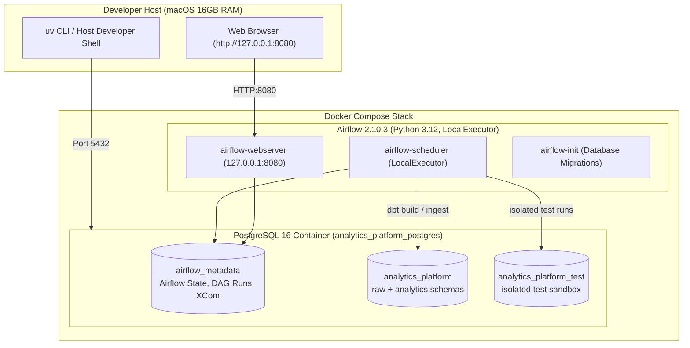
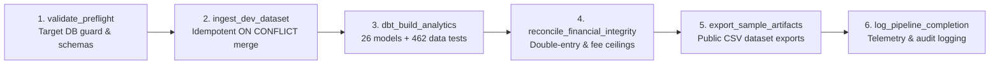
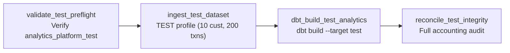

# Apache Airflow Orchestration Architecture

This document describes the design, deployment topology, and execution architecture of the Apache Airflow data pipeline orchestration layer implemented in Phase 3 of the Financial Services Analytics & AI Platform.

---

## 1. Architectural Purpose & Scope

In Phases 1 and 2, the platform established a synthetic banking data generation engine, PostgreSQL ingestion pipeline, and a 26-model dbt dimensional warehouse. While these components could be triggered manually via CLI scripts, production financial data platforms require:

1. **Automated, Scheduled Cadence:** Regular execution aligned with financial reporting periods.
2. **Deterministic Task Dependencies:** Strict topological execution ensuring upstream models and data quality gates finish before analytical marts or exports run.
3. **Robust Fault Tolerance & Retries:** Automated transient failure recovery, execution timeouts, and failure alerts.
4. **Governed Metadata & Lineage Tracking:** Comprehensive execution telemetry, audit logs, and status dashboards.
5. **Strict Database Isolation:** Complete separation between development data (`analytics_platform`), automated test execution (`analytics_platform_test`), and workflow engine state (`airflow_metadata`).

---

## 2. Infrastructure Topology

The orchestration stack runs locally via Docker Compose, optimized to run comfortably within a 16GB RAM developer environment without heavyweight distributed queues (e.g., Celery, Redis, or Kafka).

### Resource Allocation

| Container | CPU Limit | Memory Limit | Memory Reservation | Role |
| :--- | :--- | :--- | :--- | :--- |
| `analytics_platform_postgres` | 1.0 CPU | 512 MB | 128 MB | Multi-database PostgreSQL engine |
| `analytics_platform_airflow_webserver` | 1.0 CPU | 1.0 GB | 256 MB | Flask UI and REST API server |
| `analytics_platform_airflow_scheduler` | 1.0 CPU | 1.0 GB | 256 MB | LocalExecutor scheduling daemon |

---

## 3. Database Isolation Strategy

A core tenet of the platform architecture is strict isolation across database domains:

1. **Airflow Metadata Database (`airflow_metadata`):**
   - Stores Airflow internal operational state: DAG run history, task instances, XCom key-value pairs, user credentials, and session locks.
   - Completely separate from banking tables. Airflow never writes internal tables to `analytics_platform` or `analytics_platform_test`.

2. **Development Data Warehouse (`analytics_platform`):**
   - Hosts the `raw` banking tables (50 customers, 5,000 transactions, 8,289 journals, 19,053 ledger entries) and `analytics` dimensional star schema models.
   - Guarded by pre-flight checks: any pipeline attempting to run against the wrong database is immediately halted.

3. **Integration Test Sandbox (`analytics_platform_test`):**
   - Dedicated database reserved exclusively for integration test suites (`pytest`) and automated test DAGs.
   - Prevents automated tests from polluting or mutating development showcase data.

---

## 4. Governed DAG Pipelines

The platform defines two production-grade DAGs in `airflow/dags/`:

### A. DEV Daily Analytics Pipeline (`financial_analytics_dev_pipeline`)

Scheduled daily (`@daily`, `catchup=False`, `max_active_runs=1`), this DAG manages the full data lifecycle:

#### Task Breakdown:

1. **`validate_preflight` (PythonOperator):**
   - Connects to PostgreSQL using centralized `shared.config.Settings`.
   - Validates that `current_database() == 'analytics_platform'`. Raises `AirflowException` if target is incorrect.
   - Ensures `raw` and `analytics` schemas exist.
   - Generates environment-variable-driven dbt profile at `/tmp/dbt_profiles/profiles.yml`.

2. **`ingest_dev_dataset` (PythonOperator):**
   - Generates deterministic synthetic records using `SyntheticDataGenerator(profile="DEV", seed=42)`.
   - Stages and merges records using PostgreSQL `ON CONFLICT DO NOTHING` logic.
   - Zero row duplication: repeated executions leave row counts exactly unchanged.

3. **`dbt_build_analytics` (BashOperator):**
   - Invokes `dbt build --profiles-dir /tmp/dbt_profiles --target dev`.
   - Compiles and materializes 26 models (12 staging, 5 intermediate, 9 marts) and executes 462 automated generic and singular data quality tests.

4. **`reconcile_financial_integrity` (PythonOperator):**
   - Executes `DataReconciler` verifying core accounting invariants:
     - Double-entry journal balance per currency leg (`leg_diff = 0.0000`).
     - Absence of ledger postings for unsettled transactions (`FAILED` / `PENDING`).
     - Referential integrity across customers, accounts, transactions, and ledger entries.
     - Mathematical fee decomposition (`gross = waived + net`).
     - Cumulative collection ceiling enforcement (`collected <= net collectible`).

5. **`export_sample_artifacts` (PythonOperator):**
   - Invokes `export_all_samples()` writing 12 raw entity CSVs and 4 analytical marts to `sample_data/`.

6. **`log_pipeline_completion` (PythonOperator):**
   - Pulls XCom metadata from upstream tasks and outputs structured audit log with execution timing and record counts.

---

### B. Isolated Test Pipeline (`financial_analytics_test_pipeline`)

Triggered on demand or via CI (`schedule_interval=None`), this DAG runs the entire pipeline end-to-end against `analytics_platform_test`:

---

## 5. Reliability & Security Controls

1. **No External Network Dependency:**
   - Airflow runs entirely locally in Docker with zero external API requirements.
2. **Explicit User & Host Binding:**
   - Airflow webserver binds strictly to `127.0.0.1:8080`, preventing unauthorized LAN exposure.
3. **Execution Timeouts:**
   - Default timeout of 15 minutes prevents runaway hanging processes.
4. **Retry Policies:**
   - Transient failures trigger up to 2 automated retries with a 1-minute exponential backoff.
5. **Zero Hardcoded Secrets:**
   - Fernet encryption keys and database connection strings are passed exclusively through environment variables.
