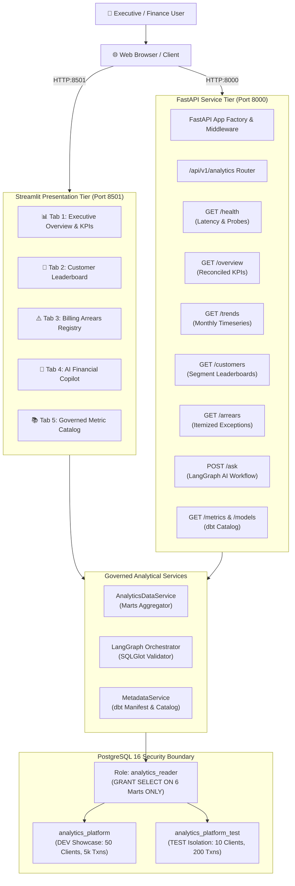

# Application Engineering & Productisation Architecture

## 1. Executive Summary

Phase 6 transforms the platform from headless computational and AI engines into a cohesive, production-grade financial data application. The application architecture consists of two interconnected presentation and service tiers:

1. **FastAPI Service Tier (`ai_services.api`)**: High-throughput REST API managing request routing, Pydantic input/output contracts, SQLGlot AST validation, least-privilege read-only PostgreSQL execution, and structured operational observability.
2. **Streamlit Executive Presentation Tier (`data_apps`)**: Multi-tab institutional financial analytics dashboard providing dynamic executive KPI tracking, revenue accounting reconciliation, customer leaderboard rankings, billing arrears management, natural-language AI inquiry, and an interactive dbt governance catalog.

---

## 2. API Contract Design & Validation

### 2.1 Pydantic Data Contracts
Every API endpoint is governed by explicit Pydantic V2 models defined in `packages/ai_services/src/ai_services/schemas.py`:

* `FinancialOverviewResponse`: 17 typed fields including net recognized revenue, gross assessed fees, fee waivers, cash collections, uncollected arrears, pass-through costs, and realization rates.
* `RevenueTrendsResponse`: Timeseries array of monthly revenue, assessed fees, and cash receipts with `YYYY-MM` keys.
* `CustomerRankingsResponse`: Customer-level performance records with revenue, fee contributions, and arrears.
* `BillingArrearsResponse`: Itemized exceptions with native and EUR-equivalent amounts, customer IDs, and fee categories.
* `AnalyticsQueryRequest` / `AnalyticsQueryResponse`: Request validation enforcing length constraints ($3 \le \text{length} \le 500$), target environment selection (`dev` vs `test`), and returning full SQL execution traces.

### 2.2 Security & Least Privilege Enforcement
All application-level database queries execute under the dedicated PostgreSQL role `analytics_reader`:
* **Zero DDL/DML**: Insert, update, delete, truncate, drop, and create are blocked at the database engine level.
* **Schema Confinement**: Access is revoked from `PUBLIC`, `raw`, and `metadata`. Access is strictly limited to 6 dimensional marts in `analytics`:
  1. `dim_accounts`
  2. `dim_customers`
  3. `fct_customer_revenue`
  4. `fct_fee_assessments`
  5. `fct_fee_collections`
  6. `fct_transactions`
* **Statement Timeouts**: Forced 5,000ms query cancellation prevents runaway queries.

---

## 3. Streamlit Executive Dashboard Design

The dashboard in `packages/data_apps/src/data_apps/app.py` features five dedicated workspaces:

### 3.1 Tab 1: Executive Overview & Financial KPIs
* **Dynamic Warehouse KPIs**: Renders real-time financial figures computed directly from warehouse data (e.g. €408,602.64 net recognized revenue, 5.28% billing exception rate, 93.63% collection realization).
* **Governed Revenue Bridge**: Renders the complete accounting reconciliation equation:
  $$\text{Gross Assessed} - \text{Waivers} = \text{Net Collectible} \rightarrow \text{Collections} - \text{Pass-Through} = \text{Net Recognized Revenue}$$
* **Monthly Trends Line Chart**: Visualizes 12 months of revenue accruals versus cash sweeps.
* **Downloadable Exports**: 1-click CSV download of monthly performance data.

### 3.2 Tab 2: Customer Rankings & Segmentation
* Filterable leaderboard by commercial segment (`INSTITUTIONAL`, `COMMERCIAL_SME`, `CORPORATE`).
* Standardized European currency formatting (`€XX,XXX.XX`).
* 1-click CSV export of customer revenue ledgers.

### 3.3 Tab 3: Billing Arrears & Exception Registry
* Authoritative tracking of **200 fee assessments** in arrears across **46 commercial accounts**, totaling **€29,280.10**.
* Granular columns: Native currency arrears, EUR-standardized arrears, fee type, and client segment.
* 1-click CSV export for finance and credit operations teams.

### 3.4 Tab 4: AI Financial Copilot
* Interactive conversational interface with one-click suggested prompts.
* Dual presentation: Executive financial explanation alongside evidence records table.
* **Security & SQL Audit Drawer**: Collapsible panel displaying the sanitized PostgreSQL query, SQLGlot AST validation badge, execution time, and model provenance.

### 3.5 Tab 5: Governed Metric Catalog
* Interactive browser of all 12 certified metrics from `financial_metrics.yaml`.
* Displays mathematical formulas, source dbt models, business definitions, and ownership tags.
* Detailed schema browser for the 6 queryable dimensional marts.

---

## 4. Operational Observability & Logging

* **Request Correlation**: The API injects a unique UUID `X-Request-ID` into every HTTP response.
* **Execution Latency**: The API measures and returns request processing time via `X-Process-Time`.
* **Health Probing**: Real-time database round-trip latency measurement in milliseconds via `/health`.
