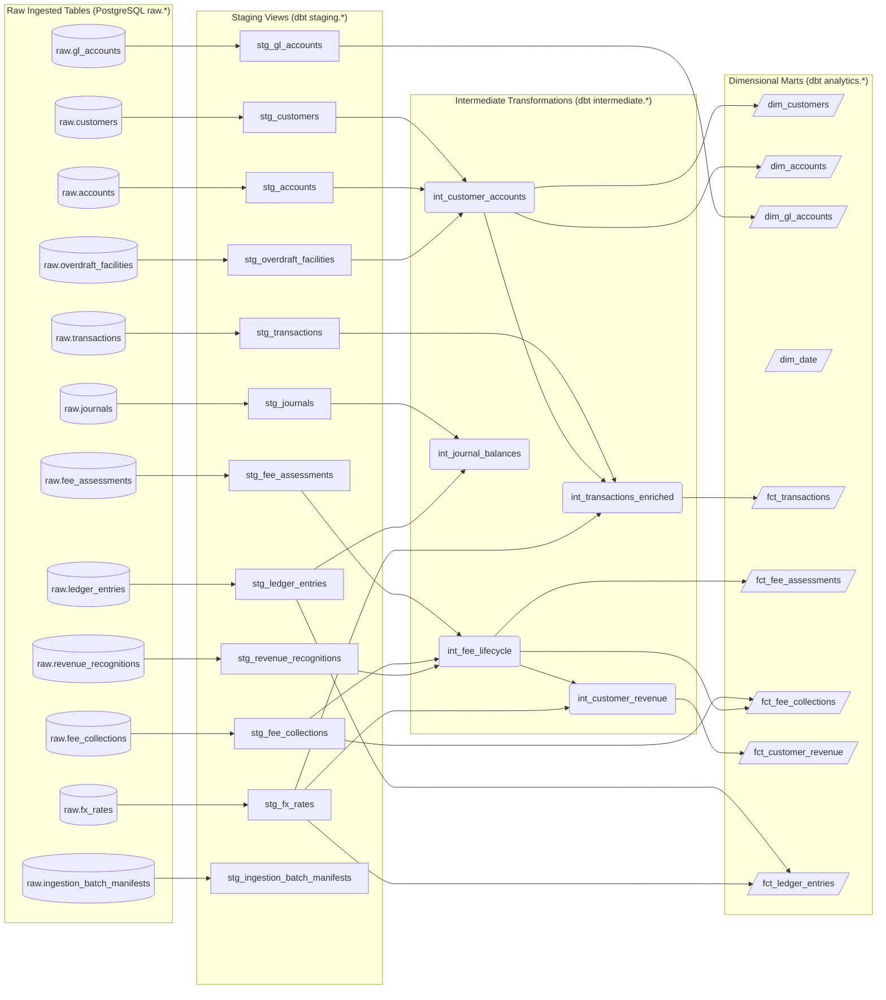

# Architecture: End-to-End Data Lineage & Dependency Graphs

## 1. Overview & Lineage Strategy

Data lineage provides complete transparency into the origin, movement, and transformation of financial records as they travel from raw synthetic banking tables to Kimball-style analytical marts.

The platform implements two complementary levels of data lineage:
1. **Model-Level Lineage (Deterministic DAG)**: Derived directly from the compiled dbt dependency graph (`parent_map` and `child_map` in `manifest.json`). Guarantees 100% accuracy of inter-model dependencies.
2. **Column-Level Lineage (Conservative AST Analysis)**: Parsed from SQL queries using `sqlglot`. Conservative analysis extracts direct column projections and tracks simple arithmetic/case statements, while explicitly tagging ambiguous or windowed expressions as `AMBIGUOUS_COMPLEX_EXPRESSION` rather than fabricating speculative column ancestry.

---

## 2. Model Dependency Graph (End-to-End)

The full platform data lineage connects the 12 raw source tables through 12 staging views and 5 intermediate tables to the 9 core and finance dimensional marts:



---

## 3. Lineage Engine API & Traversal Methods

The `LineageEngine` class in `packages/data_platform/src/data_platform/metadata/lineage.py` provides bidirectional traversal capabilities:

### 3.1 Trace Mart to Raw Sources (`trace_mart_to_sources`)
Given a business mart (e.g. `fct_customer_revenue`), traverses upstream through intermediate and staging models to discover all underlying raw sources:
```python
engine = LineageEngine(parent_map=manifest_parser.parent_map)
sources = engine.trace_mart_to_sources("model.dbt_analytics.fct_customer_revenue")
# Returns:
# [
#   'source.dbt_analytics.raw.accounts',
#   'source.dbt_analytics.raw.customers',
#   'source.dbt_analytics.raw.fee_assessments',
#   'source.dbt_analytics.raw.fee_collections',
#   'source.dbt_analytics.raw.fx_rates',
#   'source.dbt_analytics.raw.revenue_recognitions'
# ]
```

### 3.2 Trace Source to Downstream Marts (`trace_source_to_marts`)
Given a raw source table (e.g. `raw.fee_assessments`), traverses downstream to determine which dimensional marts will be affected by schema changes or upstream data anomalies:
```python
marts = engine.trace_source_to_marts("source.dbt_analytics.raw.fee_assessments")
# Returns:
# [
#   'model.dbt_analytics.fct_customer_revenue',
#   'model.dbt_analytics.fct_fee_assessments',
#   'model.dbt_analytics.fct_fee_collections'
# ]
```

---

## 4. Column-Level Lineage with SQLGlot

The `ColumnLineageAnalyzer` uses SQLGlot's AST visitor to extract conservative column-to-column dependencies from model queries.

### Rules:
1. **Direct Projection**: `SELECT c.customer_id AS id` -> `id: ["customer_id"]`.
2. **Explicit Casts**: `SELECT CAST(amount AS numeric(18,4)) AS txn_amt` -> `txn_amt: ["amount"]`.
3. **Multi-Column Arithmetic**: `SELECT gross_amount - waived_amount AS net_amount` -> `net_amount: ["gross_amount", "waived_amount"]`.
4. **Ambiguous Window / Aggregation**: `SELECT SUM(amount) OVER (...)` -> mapped only to contained column identifiers without fabricating upstream columns.
5. **Jinja Pre-Processing**: Strips `{{ ref(...) }}` and `{{ source(...) }}` macros to valid SQL table aliases before AST parsing, avoiding unparseable syntax errors.
