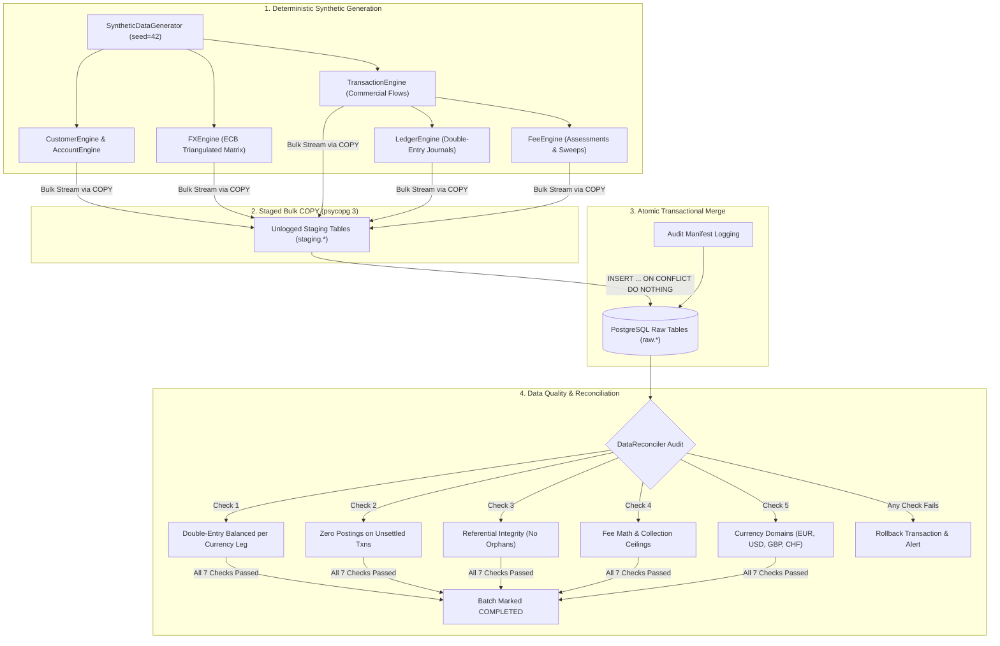
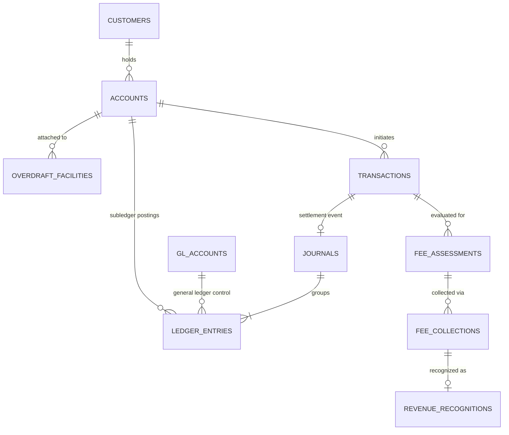

# Ingestion Pipeline Architecture

## High-Throughput PostgreSQL Batch Ingestion

This document details the architecture and operational mechanics of the synthetic data ingestion pipeline powering the Enterprise AI Analytics Platform.

---

## 1. End-to-End Pipeline Workflow

The ingestion pipeline decouples memory-intensive synthetic banking generation from relational persistence using unlogged staging tables, binary-efficient streaming `COPY`, and atomic transactional merges:



---

## 2. Ingestion Mechanics & Design Decisions

### A. Unlogged Staging Tables
To achieve multi-thousand row-per-second ingestion without saturating disk I/O on development machines (16GB RAM Mac), the pipeline loads records into PostgreSQL `UNLOGGED` tables in the `staging` schema. Unlogged tables bypass Write-Ahead Logging (WAL) during the copy phase.

### B. Streaming COPY Protocol
Rather than generating thousands of parameterized `INSERT` statements, the pipeline uses `psycopg 3` COPY streams:
```python
with cur.copy("COPY staging.transactions FROM STDIN") as copy:
    for t in data.transactions:
        copy.write_row(...)
```

### C. Idempotent Transactional Merge
Once all tables are staged, the pipeline merges records into `raw.*` tables within a single database transaction using `ON CONFLICT (pk) DO NOTHING`. This ensures:
- Safe rerunability on duplicate executions.
- Zero duplicate records created on retries.
- Foreign key constraints are enforced atomically.
- Failures result in complete rollback, leaving no partial batches.

---

## 3. Entity-Relationship Data Model (Raw Schema)


