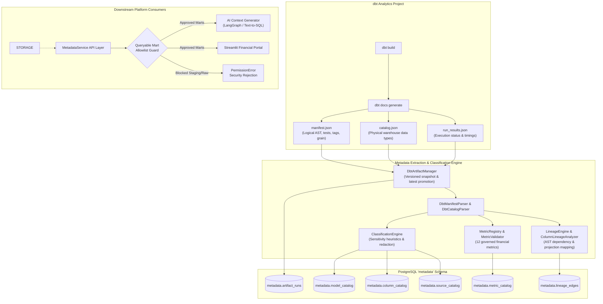

# Architecture: Governed Metadata Catalog & Lifecycle Management

## 1. Executive Summary & Purpose

The **Governed Metadata Catalog** serves as the authoritative metadata registry, governance control plane, and semantic interface for the Financial Services Analytics & AI Platform.

In an enterprise banking environment, analytical fact and dimension models must not be treated as opaque database tables. Autonomous AI workflows, text-to-SQL generation engines, and human decision-makers require rich semantic context:
- Documented business definitions and business purpose.
- Explicit grain specifications (e.g. one row per `transaction_id`).
- Governed financial metrics with certified algebraic formulas.
- Data classification sensitivity tiers (`PUBLIC`, `INTERNAL`, `CONFIDENTIAL`, `RESTRICTED`).
- Upstream and downstream lineage from raw source feeds through intermediate transformations to business marts.
- Verified physical data types and active data quality test assertions.

---

## 2. Extraction Pipeline & Architecture Components

### 2.1 Artifact Publishing & Snapshot Versioning (`DbtArtifactManager`)
When `dbt build` and `dbt docs generate` complete:
1. `DbtArtifactManager` validates that `manifest.json`, `catalog.json`, and `run_results.json` exist and contain non-empty top-level keys.
2. A timestamped and UUID-tagged snapshot directory is created at `artifacts/dbt/<target>/<run_id>/`.
3. If build status is `SUCCESS`, the snapshot is atomically promoted to `artifacts/dbt/<target>/latest/`.
4. Artifact telemetry (model count, test count, dbt version, schema) is compiled into an `ArtifactRun` record.

### 2.2 Semantic Extraction & Synthesis
- **`DbtManifestParser`**: Reads models, sources, seeds, and test nodes. Extracts column descriptions, model tags, grains, foreign key relationships, and adjacency parent/child dependency maps.
- **`DbtCatalogParser`**: Inspects physical PostgreSQL information schema types (e.g. `numeric(18,4)`, `character varying(64)`, `timestamp with time zone`) and ordinal positions, merging them with logical column metadata.
- **`ClassificationEngine`**: Applies enterprise sensitivity rules, mapping columns to `CONFIDENTIAL`, `RESTRICTED`, or `INTERNAL` based on naming heuristics and YAML meta tags.
- **`LineageEngine`**: Constructs directed graph edges (`LineageEdge`) across models, sources, and columns.
- **`MetricRegistry` & `MetricValidator`**: Ingests governed financial metrics, verifying that referenced models, columns, and SQL expressions are valid.

---

## 3. Storage Architecture: PostgreSQL `metadata` Schema

The persistence layer stores catalog snapshots transactionally in PostgreSQL:

| Table Name | Grain | Description |
| :--- | :--- | :--- |
| `metadata.artifact_runs` | `run_id` | Historical log of dbt artifact compilations, timings, and latest state. |
| `metadata.classification_catalog` | `classification_id` | Master sensitivity tiers (`PUBLIC`, `INTERNAL`, `CONFIDENTIAL`, `RESTRICTED`). |
| `metadata.model_catalog` | `model_id` | Governed models, materializations, layer, grain, queryable flag, and tests. |
| `metadata.column_catalog` | `column_id` | Physical data types, ordinal positions, descriptions, classifications, and lineage. |
| `metadata.source_catalog` | `source_id` | Raw database tables ingested from banking operational systems. |
| `metadata.metric_catalog` | `metric_id` | Governed financial performance metrics with formulas and multi-currency rules. |
| `metadata.lineage_edges` | `edge_id` | Directed model-to-model and source-to-model dependency graph edges. |

---

## 4. Governed Security Boundary: Queryable Model Allowlist

To eliminate hallucinations and prevent AI agents from generating SQL against uncurated staging tables or raw tables, the `MetadataService` enforces a strict allowlist:

### 4.1 Permitted Models
- `dim_customers`: Customer master dimension.
- `dim_accounts`: Bank account holdings and subledger balances.
- `dim_gl_accounts`: General Ledger Chart of Accounts.
- `dim_date`: Enterprise calendar date dimension.
- `fct_transactions`: Commercial payments and payment rails.
- `fct_fee_assessments`: Contractual fee assessments, waivers, and net collectible amounts.
- `fct_fee_collections`: Collection attempts, sweep execution, and cash realization.
- `fct_customer_revenue`: Monthly customer fee profitability and revenue recognition.
- `fct_ledger_entries`: Double-entry general ledger postings.

### 4.2 Prohibited Models
- Raw sources (`raw.*`): Direct raw tables lack dimensional joins and business definitions.
- Staging models (`stg_*`): Transient 1-to-1 cleanses.
- Intermediate models (`int_*`): Non-surfaced multi-table business joins.

If an AI agent requests context for `stg_transactions` or `raw.transactions`, `MetadataService.build_ai_query_context()` immediately raises `PermissionError` and halts execution.
