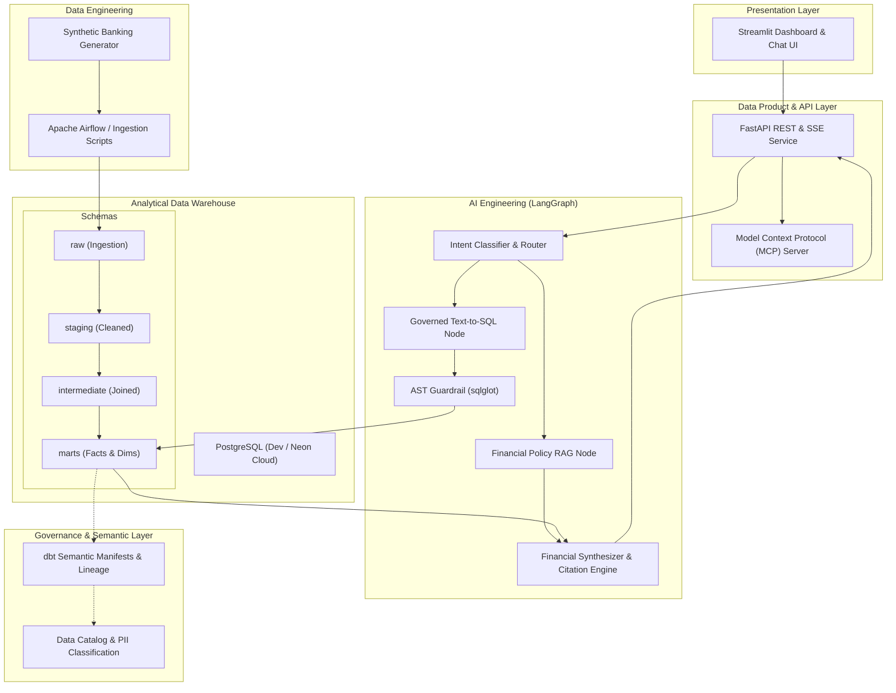

# System Architecture Overview

The platform uses a layered architecture separating physical storage, analytical transformation, governance metadata, agentic AI reasoning, and presentation.

---

## Architectural Diagram

---

## Component Boundaries

### 1. Ingestion & Transformation Layer
- **Raw Stage**: Stores immutable synthetic events (customer profiles, account creation, wire/card transactions, fee schedules).
- **Staging (`stg_`)**: Type casting, naming normalization, currency formatting, deduplication.
- **Intermediate (`int_`)**: Financial joins between transactions and tiered pricing policies.
- **Marts (`fct_`, `dim_`)**: Dimensional star schema optimized for fast analytical aggregations.

### 2. Governance & Metadata Layer
- **dbt Manifests**: Authoritative definitions of metrics, column descriptions, and lineage graphs.
- **PII Classification**: Automatic tagging of sensitive identifiers (account numbers, customer tax IDs).

### 3. AI & Agentic Layer
- **LangGraph Multi-Agent Workflow**: Coordinates question decomposition, tool invocation, and evidence synthesis.
- **AST SQL Guardrails (`sqlglot`)**: Enforces `SELECT`-only execution, validates metric aliases, caps `LIMIT <= 1000`, and rejects destructive statements.
- **RAG Subsystem**: Retrieves contractual terms, fee discount waivers, and SLA agreements to support analytical answers.

### 4. Data Product & Presentation
- **FastAPI**: Asynchronous API server streaming agent thoughts and SQL execution plans via Server-Sent Events (SSE).
- **Streamlit**: Interactive executive dashboards with Plotly financial visualizations and conversational assistance.
