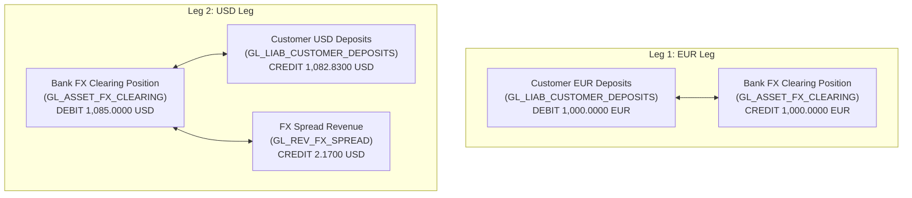
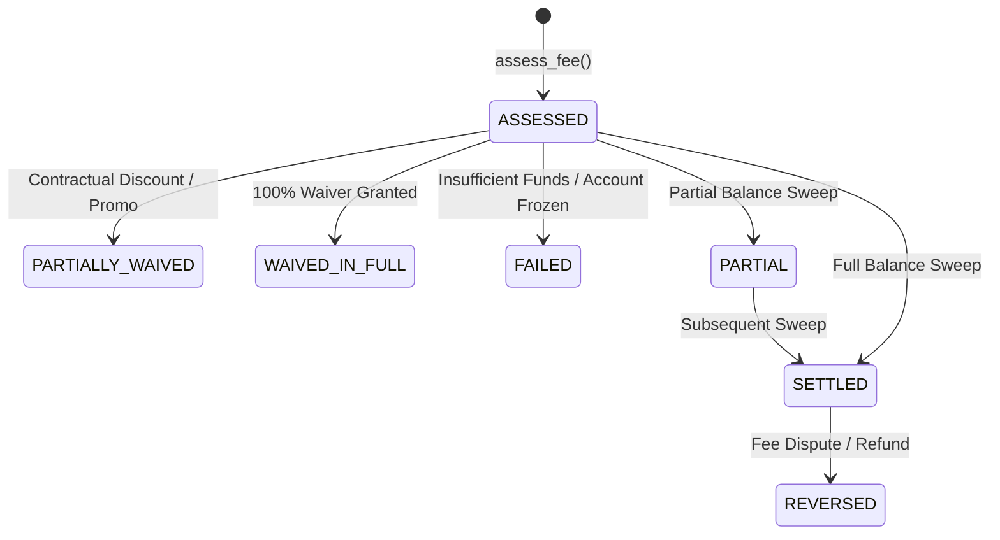

# Phase 1: Synthetic Financial Data Generation & Accounting Engine

## Overview & Architecture

Phase 1 provides the synthetic data generation foundation for the Enterprise AI Analytics Platform. Rather than producing superficial mock data, it implements an authoritative financial simulation enforcing double-entry general ledger bookkeeping, multi-currency foreign exchange settlement, and contractual fee billing lifecycles.

---

## 1. FX Accounting Review & T-Account Analysis

### Economic Context: Customer Sells EUR 1,000 to Receive USD

Consider a corporate customer initiating an FX conversion:
- **Customer sells**: `1,000.0000 EUR`
- **Mid-market exchange rate**: `1.085000` (1 EUR = 1.0850 USD)
- **Customer realized rate (20 bps margin)**: `1.082830`
- **Customer receives**: `1,082.8300 USD`
- **Bank realized FX spread revenue**: `2.1700 USD`

### Accounting Model & T-Accounts

The transaction generates two independently balanced single-currency legs bridged by the bank's internal foreign exchange clearing position (`GL_ASSET_FX_CLEARING`):

### Detailed T-Account Table

| Currency | Account | Normal Balance | Posting Type | Amount | Economic Interpretation |
| :--- | :--- | :--- | :--- | :--- | :--- |
| **EUR** | `GL_LIAB_CUSTOMER_DEPOSITS` | CREDIT | **DEBIT** | 1,000.0000 | Bank's EUR liability decreases (customer balance reduced) |
| **EUR** | `GL_ASSET_FX_CLEARING` | DEBIT | **CREDIT** | 1,000.0000 | Bank receives EUR 1,000 into its open FX inventory |
| **USD** | `GL_ASSET_FX_CLEARING` | DEBIT | **DEBIT** | 1,085.0000 | Bank delivers USD 1,085 from its open FX inventory |
| **USD** | `GL_LIAB_CUSTOMER_DEPOSITS` | CREDIT | **CREDIT** | 1,082.8300 | Bank's USD liability increases (customer receives USD) |
| **USD** | `GL_REV_FX_SPREAD` | CREDIT | **CREDIT** | 2.1700 | Bank recognizes realized trading spread revenue once |

### Currency Leg Balances & Reconciliation

- **EUR Leg Total**: Debits = Credits = `1,000.0000 EUR`
- **USD Leg Total**: Debits = Credits = `1,085.0000 USD` (`1,082.8300 + 2.1700`)
- **FX Spread Recognition**: Realized spread is recognized **exactly once** in destination currency (USD) at transaction time.

---

## 2. Documented Accounting Assumptions & Simplifications

1. **FX Clearing Position**: `GL_ASSET_FX_CLEARING` functions as an open multi-currency suspense and position account. Across conversions, it accumulates per-currency debit and credit balances representing the bank's net open currency exposure.
2. **Card Settlement Clearing**: Card transactions clear through `GL_ASSET_CENTRAL_BANK` as a generalized settlement rail, avoiding unnecessary card scheme clearing complexity before dbt modelling.
3. **Two-Way Payment Directionality**: Wire transfers and ACH payments support both outbound customer payments (`DEBIT`) and inbound customer receipts (`CREDIT`), while card settlements and FX conversions represent customer outbound flows (`DEBIT`).
4. **Append-Only Reversals**: Full and partial reversals generate explicit new reverse journals referencing the original posting ID with cumulative ceiling protection (max 100%).

---

## 3. M1.4: Fee Assessment & Collection Engine

The Fee Engine (`FeeEngine`) decouples fee assessment from collection execution to model real-world banking operations.

### Fee Lifecycle States

### Governing Pricing Schedules

Standard governed base fees and variable basis points per transaction type and customer segment:
- **Institutional Wire**: `15.00 EUR` flat + `5 bps` (`0.0005`)
- **Commercial SME Wire**: `10.00 EUR` flat + `10 bps` (`0.0010`)
- **Retail Wealth Wire**: `5.00 EUR` flat + `15 bps` (`0.0015`)
- **Standard SEPA ACH**: `0.50 EUR` flat
- **Card Merchant Interchange**: `0.20 EUR` flat + `120 bps` (`0.0120`)

### Double-Entry Accounting for Collected Fees

When a fee collection succeeds:
- **DEBIT**: `GL_LIAB_CUSTOMER_DEPOSITS` (Customer balance decreases)
- **CREDIT**: Appropriate fee revenue account (`GL_REV_WIRE_FEES`, `GL_REV_ACH_FEES`, `GL_REV_CARD_FEES`, `GL_REV_FX_SPREAD`)
- **Pass-Through Expense**: External clearing costs are logged in `RevenueRecognitionRecord` and netted against gross collections to compute net recognized revenue.

---

## 4. M1.5: PostgreSQL Raw Schema & Staging Pipeline

The ingestion pipeline delivers high-throughput, idempotent ingestion from Python into PostgreSQL 16 using unlogged staging tables, binary-efficient `COPY` streaming, and transactional SQL merges.

```mermaid
flowchart LR
    A[Synthetic Data Generator] -->|Stream In Chunks| B[Unlogged Staging Tables]
    B -->|Validate Constraints| C[Transactional SQL Merge]
    C -->|Idempotent ON CONFLICT| D[PostgreSQL Raw Tables]
    D -->|Post-Load Quality Audit| E[Data Reconciler]
    E -->|7 Invariants Verified| F[Ingestion Batch Manifest]
```

### PostgreSQL Raw Tables Architecture

All financial tables use `NUMERIC(18, 4)` for monetary amounts, `NUMERIC(18, 6)` for exchange rates, and `NUMERIC(7, 4)` for interest rates:

1. `raw.gl_accounts`: Master chart of accounts (14 standard bank GL accounts).
2. `raw.customers`: Customer profiles across Institutional, Commercial SME, and Retail Wealth.
3. `raw.accounts`: Multi-currency customer bank accounts subledger.
4. `raw.overdraft_facilities`: Credit agreements and penalty rate terms.
5. `raw.fx_rates`: Historical daily triangulated ECB cross-rate matrix.
6. `raw.transactions`: Commercial payment, wire, card, and FX operations.
7. `raw.journals`: Double-entry accounting journal events grouping balanced legs.
8. `raw.ledger_entries`: Append-only debit/credit ledger postings.
9. `raw.fee_assessments`: Contractual pricing evaluations and fee waivers.
10. `raw.fee_collections`: Collection execution sweeps and failure tracking.
11. `raw.revenue_recognitions`: Net recognized revenue after pass-through costs.
12. `raw.ingestion_batch_manifests`: Audit lineage headers tracking batches.

### Governed SQL Files

In compliance with project engineering standards, SQL queries and schema DDL are stored in dedicated, inspectable SQL files:
- [`schema_raw.sql`](file:///Users/soremekuns/test/packages/data_platform/src/data_platform/sql/schema_raw.sql): Raw table DDL, foreign keys, and indexes.
- [`schema_staging.sql`](file:///Users/soremekuns/test/packages/data_platform/src/data_platform/sql/schema_staging.sql): Unlogged staging tables for fast `COPY`.
- [`merge_staging_to_raw.sql`](file:///Users/soremekuns/test/packages/data_platform/src/data_platform/sql/merge_staging_to_raw.sql): Transactional idempotent merge logic.
- [`reconciliation.sql`](file:///Users/soremekuns/test/packages/data_platform/src/data_platform/sql/reconciliation.sql): Automated reconciliation queries.

### Automated Reconciliation Checks

Every ingested batch automatically validates 7 invariants before marking completion:

| Check Name | Target Table | Rule & Economic Invariant |
| :--- | :--- | :--- |
| `DOUBLE_ENTRY_JOURNAL_BALANCING` | `raw.ledger_entries` | Every journal must balance per currency leg ($\sum \text{debits} = \sum \text{credits}$). |
| `NO_POSTINGS_FOR_UNSETTLED_TXNS` | `raw.transactions` | Transactions with status `FAILED` or `PENDING` must have zero ledger postings. |
| `ACCOUNT_CUSTOMER_REFERENTIAL_INTEGRITY` | `raw.accounts` | Every bank account must link to a valid customer record. |
| `TRANSACTION_ACCOUNT_REFERENTIAL_INTEGRITY` | `raw.transactions` | Every transaction must originate from a valid bank account. |
| `FEE_ASSESSMENT_DECOMPOSITION` | `raw.fee_assessments` | $\text{Gross Assessed} = \text{Waived} + \text{Net Collectible}$. |
| `FEE_COLLECTION_CEILING_ENFORCEMENT` | `raw.fee_collections` | $\sum \text{Collected} \le \text{Net Collectible}$ across all retry attempts. |
| `SUPPORTED_CURRENCY_DOMAINS` | `raw.accounts` | Currencies must belong to approved domain (`EUR`, `USD`, `GBP`, `CHF`). |

