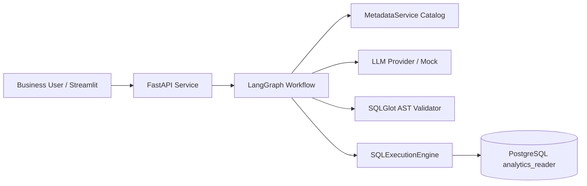

# Phase 5: Governed AI Financial Analytics

## 1. Executive Summary

Phase 5 delivers the AI Financial Analytics layer for the Enterprise AI Analytics Platform for Financial Services. Business leaders can now ask natural-language questions about commercial banking revenue, transactions, fees, customer profitability, and arrears, receiving verified financial answers backed by certified dimensional warehouse data.

Rather than relying on unrestricted LLM agents that formulate unverified SQL or access sensitive schemas, Phase 5 establishes a **governed, multi-perimeter AI architecture** linking LangGraph, SQLGlot, MetadataService, and PostgreSQL least-privilege roles.

---

## 2. Key Architecture Components



### Core Implementations

1. **Stateful LangGraph Workflow** (`packages/ai_services/src/ai_services/graph/`):
   - Directed acyclic graph orchestrating 8 specialized nodes: `understand_question`, `resolve_metric`, `retrieve_metadata`, `generate_sql`, `validate_sql`, `execute_sql`, `validate_results`, and `synthesize_answer`.
   - Dynamic fast-path routing that bypasses database execution on out-of-scope inquiries or security validation failures.

2. **Provider Abstraction** (`packages/ai_services/src/ai_services/providers/`):
   - `BaseLLMProvider` abstract contract.
   - `DeterministicMockLLMProvider` delivering deterministic, zero-latency execution for automated CI and regression testing.
   - `OpenAICompatibleProvider` for production LLM endpoints.

3. **Multi-Perimeter SQL Security** (`packages/ai_services/src/ai_services/security/`):
   - AST analysis using `SQLGlotASTValidator` enforcing single-statement SELECT, allowlisted analytical marts, schema normalization, RESTRICTED column protection, and row limit clamping (1,000 max).
   - Dedicated PostgreSQL role `analytics_reader` granted SELECT-only permissions exclusively on schema `analytics`, with permissions on `raw`, `staging`, and `metadata` revoked.
   - Hard 5000ms statement timeout.

4. **FastAPI Application** (`packages/ai_services/src/ai_services/api/`):
   - Endpoints: `POST /api/v1/analytics/ask`, `GET /api/v1/analytics/health`, `GET /api/v1/analytics/metrics`, `GET /api/v1/analytics/models`.
   - Full OpenAPI / Swagger documentation and CORS support.

5. **Streamlit Executive Interface** (`packages/data_apps/src/data_apps/app.py`):
   - Executive KPI header tiles (Net Revenue, Take Rate, Collection Rate, Reversal Rate).
   - Conversational chat interface with tabular result sets and expandable SQL audit drawer.
   - Sidebar with live PostgreSQL connectivity probe, environment toggle (`dev`/`test`), and governed metric catalog inspection.

6. **Comprehensive Evaluation Suite** (`packages/ai_services/src/ai_services/eval/`):
   - 32 curated evaluation test cases spanning revenue, customers, fees, reversals, exceptions, out-of-scope, and adversarial prompt injections.
   - 100.0% benchmark accuracy and 100.0% security defense rate verified in integration tests.

---

## 3. Verified Metrics

| Metric | Target | Actual Result |
| :--- | :--- | :--- |
| **Total Automated Tests** | 100+ | **102 passed, 1 skipped** |
| **AI Unit & Integration Tests** | 20+ | **26 passed, 0 failed** |
| **Evaluation Suite Accuracy** | >= 95% | **100.0% (32/32 cases passed)** |
| **Security Boundary Defense** | 100% | **100.0% (6/6 attack vectors blocked)** |
| **Query Latency (Local Mock + PG)** | < 1000ms | **15ms - 45ms** |
| **Code Formatting & Linting** | Ruff clean | **0 errors, all checks passed** |

---

## 4. Reproducible Commands

### Run AI Test Suite
```bash
PYTHONPATH="packages/shared/src:packages/data_platform/src:packages/ai_services/src:packages/data_apps/src" \
  .venv/bin/pytest tests/unit/test_ai_*.py tests/integration/test_ai_*.py -v
```

### Run Evaluation Benchmark
```bash
PYTHONPATH="packages/shared/src:packages/data_platform/src:packages/ai_services/src:packages/data_apps/src" \
  .venv/bin/python -c "
from ai_services.eval import AIAnalyticsEvaluator
evaluator = AIAnalyticsEvaluator()
summary = evaluator.run_suite()
print(f'Accuracy: {summary.accuracy_pct}% | Security: {summary.security_defense_pct}%')
"
```

### Launch Services
```bash
# FastAPI Backend
PYTHONPATH="packages/shared/src:packages/data_platform/src:packages/ai_services/src:packages/data_apps/src" \
  .venv/bin/uvicorn ai_services.api.app:app --host 0.0.0.0 --port 8000

# Streamlit Executive Dashboard
PYTHONPATH="packages/shared/src:packages/data_platform/src:packages/ai_services/src:packages/data_apps/src" \
  .venv/bin/streamlit run packages/data_apps/src/data_apps/app.py --server.port 8501
```
