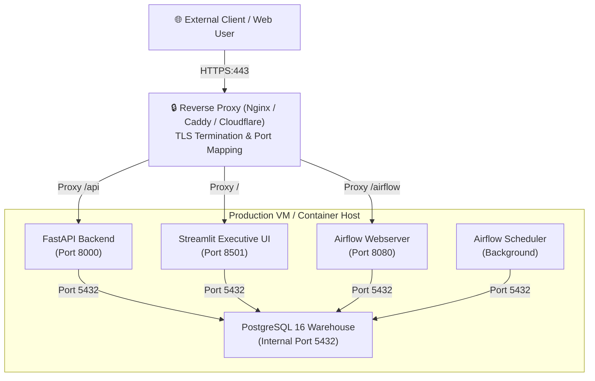

# Production Deployment & Hosting Runbook

## 1. Deployment Architecture

The Enterprise AI Analytics Platform is designed for single-node container deployment or modular cloud orchestration, compatible with lightweight VM hosts (e.g., AWS EC2 t4g.medium, GCP e2-medium, Hetzner CAX21) and managed container services (e.g., Render, Railway, Fly.io).



---

## 2. Production Docker Deployment

### 2.1 Host Prerequisites
* **Operating System**: Linux (Ubuntu 22.04 LTS / Debian 12 / AlmaLinux 9) or macOS
* **RAM**: Minimum 4GB RAM (8GB+ recommended for Airflow concurrent runs)
* **Disk**: 20GB SSD
* **Docker Engine**: Docker 24.0+ and Docker Compose v2

### 2.2 Setup Procedure

1. **Clone and Navigate**:
   ```bash
   git clone https://github.com/mrsimiloluwa/test.git
   cd test
   ```

2. **Configure Environment Variables**:
   ```bash
   cp .env.example .env
   ```
   Edit `.env` to configure production secrets:
   ```bash
   APP_ENV=production
   LOG_LEVEL=INFO
   POSTGRES_USER=analytics_admin
   POSTGRES_PASSWORD=your_secure_admin_password
   POSTGRES_READER_PASSWORD=your_secure_reader_password
   API_AUTH_ENABLED=true
   API_KEY=your_secure_api_key_for_clients
   LLM_PROVIDER=openai  # or mock
   LLM_API_KEY=sk-...
   ```

3. **Build Application Containers**:
   ```bash
   docker compose build
   ```

4. **Launch Multi-Container Stack**:
   ```bash
   docker compose up -d
   ```

5. **Verify Running Services**:
   ```bash
   docker compose ps
   ```

---

## 3. Public Cloud Deployment

### 3.1 Streamlit Community Cloud (Standalone Embedded Architecture — Recommended)

The recommended deployment for public exploration is **Streamlit Community Cloud** running entirely in-process with the packaged synthetic DEV showcase dataset loaded into an embedded **DuckDB** analytical warehouse. This requires **zero external cloud databases**, **zero external database credentials**, and **zero cloud hosting fees**.

```mermaid
graph TD
    User["🌐 Web User / Explorer"]
    
    subgraph Streamlit_Community_Cloud ["Streamlit Community Cloud (Free Serverless)"]
        UI["Streamlit Executive UI<br/>(packages/data_apps/src/data_apps/app.py)"]
        AnalyticsSvc["AnalyticsDataService<br/>(In-Process Analytical Layer)"]
        AIWorkflow["LangGraph State Machine<br/>(Deterministic Mock Inference)"]
        DuckDB["DuckDB In-Memory Marts<br/>(analytics.dim_*, analytics.fct_*)"]
    end

    subgraph Git_Repo ["GitHub Repository (Packaged Assets)"]
        CSVs["sample_data/*.csv<br/>(DEV Showcase: 50 Clients, 5k Txns)"]
        dbtTarget["dbt Target Manifest & Catalog<br/>(packages/data_platform/dbt_analytics/target)"]
        CatalogYAML["financial_metrics.yaml<br/>(12 Governed Metrics)"]
    end

    User -->|HTTPS:443| UI
    UI --> AnalyticsSvc
    UI --> AIWorkflow
    AnalyticsSvc --> DuckDB
    AIWorkflow --> DuckDB
    DuckDB -.->|In-Memory Cold Start Load (~200ms)| CSVs
    AIWorkflow -.->|Metadata Fallback| dbtTarget
    AIWorkflow -.->|Metric Catalog| CatalogYAML
```

#### Turnkey Deployment Steps:
1. Fork or push the repository to GitHub.
2. Log in to [Streamlit Community Cloud](https://share.streamlit.io/).
3. Click **"Create app"** and select your repository.
4. Set **Main file path**: `packages/data_apps/src/data_apps/app.py`.
5. *(Optional)* In **App settings -> Secrets**, paste the following template from `.streamlit/secrets.toml.example` (defaults are automatic even without secrets):
   ```toml
   # Embedded standalone mode (zero external database credentials)
   DATABASE_BACKEND = "duckdb"
   APP_ENV = "production"
   LLM_PROVIDER = "mock"
   REPORTING_BASE_CURRENCY = "EUR"
   ```
6. Click **Deploy!** The application boots in under 15 seconds, automatically mounts the 6 packaged DEV analytical marts into DuckDB, and serves executive KPIs, monthly trends, customer leaderboards, billing arrears exceptions, the governed metric catalog, and conversational AI answers.

---

### 3.2 Optional External Database Integration (Neon / Managed PostgreSQL)

If you specifically require hosting a dedicated PostgreSQL instance instead of the embedded DuckDB warehouse:
1. Provision a PostgreSQL instance (e.g. [Neon.tech](https://neon.tech/) with SSL).
2. Run database migration and dbt build against the target instance.
3. Configure the following secrets in Streamlit Cloud:
   ```toml
   DATABASE_BACKEND = "postgres"
   POSTGRES_HOST = "ep-cool-fog-123456.us-east-2.aws.neon.tech"
   POSTGRES_PORT = 5432
   POSTGRES_DB = "analytics_platform"
   POSTGRES_READER_USER = "analytics_reader"
   POSTGRES_READER_PASSWORD = "your_secure_neon_reader_password"
   POSTGRES_SSLMODE = "require"
   LLM_PROVIDER = "mock"
   ```

---

### 3.3 Render / Railway (Full Multi-Container Stack with Airflow)
1. Deploy via `docker-compose.yml` on a single-node VPS or Railway template.
2. Maps port `8000` for FastAPI, port `8501` for Streamlit, and port `8080` for Airflow Webserver.
3. Attaches persistent volume on `/var/lib/postgresql/data` for PostgreSQL persistence.

---

## 4. Post-Deployment Verification & Smoke Tests

Execute smoke tests against the deployed host:

```bash
# 1. API Health Check
curl -s https://your-host:8000/health | jq .

# 2. Telemetry and Operational Metrics
curl -s https://your-host:8000/telemetry | jq .

# 3. Dynamic Overview Query
curl -s -H "X-API-Key: your_key" "https://your-host:8000/api/v1/analytics/overview?environment=dev" | jq .

# 4. Streamlit Health Check
curl -s -i https://your-host:8501/_stcore/health
```

---

## 5. Backup and Maintenance

### 5.1 Database Backup
```bash
docker compose exec postgres pg_dump -U analytics_user -d analytics_platform > backup_dev_$(date +%F).sql
```

### 5.2 Database Restoration
```bash
docker compose exec -T postgres psql -U analytics_user -d analytics_platform < backup_dev_YYYY-MM-DD.sql
```

---

## 6. Operational Troubleshooting & Failure Scenarios

### 6.1 Cold-Start & Inactivity Spin-Down
- **Symptom**: On free hosting tiers (e.g., Streamlit Community Cloud or Render Free), requests may take 20–40 seconds on first load after inactivity.
- **Cause**: Container suspended to save compute resources.
- **Resolution**:
  - The frontend displays an automatic wake-up spinner.
  - For continuous availability without sleep states, use Railway ($5/mo) or a single-node VPS (€3.79/mo).

### 6.2 Connection Pool Saturation
- **Symptom**: `OperationalError: remaining connection slots are reserved for non-replication superuser connections`.
- **Cause**: Too many concurrent Streamlit threads or API workers exceeding PostgreSQL `max_connections`.
- **Resolution**:
  - Adjust `DB_POOL_MAX_SIZE=5` in `.env`.
  - Ensure all database connections use Python context managers (`with get_postgres_reader_connection() as conn:`) which automatically return connections to the pool upon completion.

### 6.3 Statement Timeout Enforcement (`5000ms`)
- **Symptom**: `QueryCanceled: canceling statement due to statement timeout`.
- **Cause**: AI or user executed an unindexed or Cartesian join exceeding the 5,000ms safety threshold.
- **Resolution**:
  - Expected behavior: protects the warehouse from runaway queries.
  - Ensure queries use indexed join columns (e.g., `customer_id`, `account_id`) or filter by `transaction_date`.

### 6.4 API Authentication Rejection (`401 Unauthorized`)
- **Symptom**: `401 Unauthorized: Invalid or missing API key`.
- **Cause**: Client omitted the `X-API-Key` or `Authorization: Bearer <key>` header when `API_AUTH_ENABLED=true`.
- **Resolution**:
  - Pass the key in headers: `curl -H "X-API-Key: $API_KEY" ...`
  - In development or local demonstration, set `API_AUTH_ENABLED=false` in `.env` to allow anonymous access.
