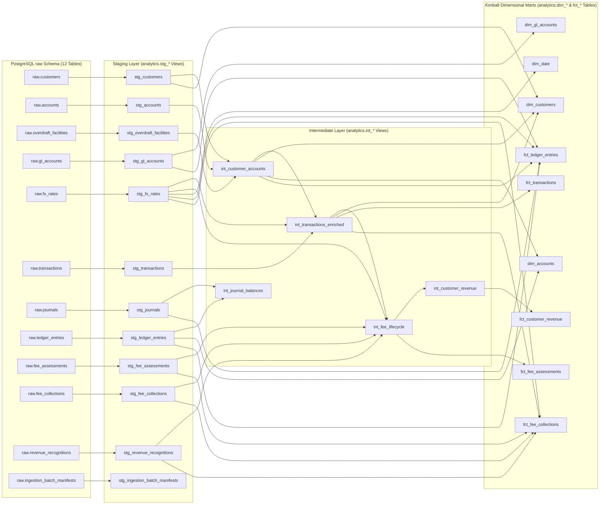
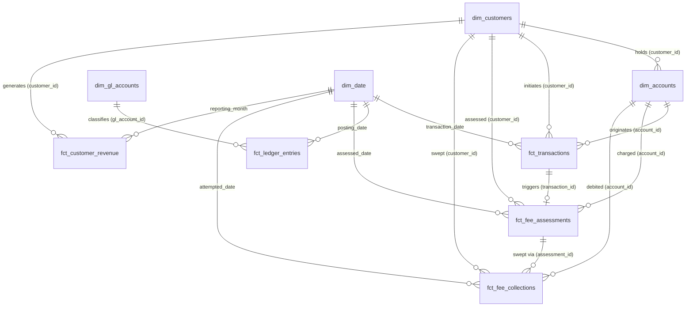
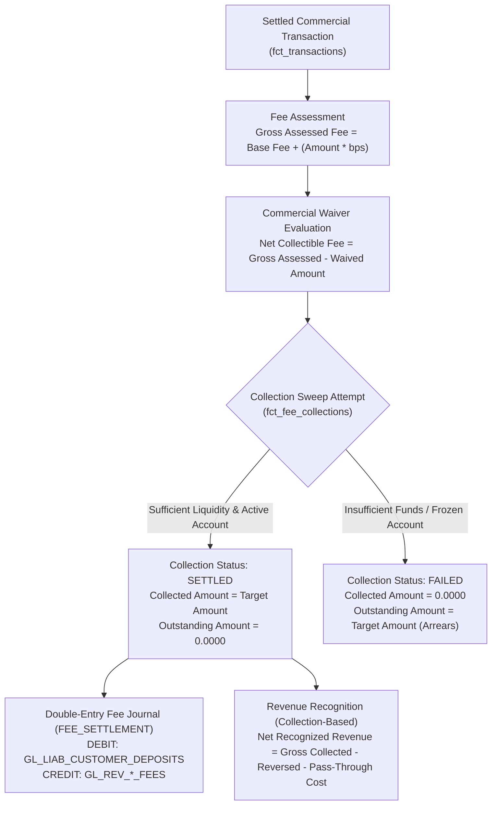

# Data Lineage & Dimensional Architecture

This document illustrates the end-to-end lineage from the PostgreSQL `raw` schema through the dbt staging, intermediate, and Kimball dimensional mart layers in the `analytics` schema.

---

## 1. End-to-End dbt DAG Lineage



---

## 2. Dimensional Star Schema Relationships



---

## 3. Financial Fee Lifecycle & Revenue Calculation Flow



---

## 4. Accessing Interactive dbt Documentation

The dbt documentation catalog (`target/catalog.json`) and manifest (`target/manifest.json`) are generated via:

```bash
.venv/bin/uv run --env-file .env dbt docs generate \
  --project-dir packages/data_platform/dbt_analytics \
  --profiles-dir /tmp/dbt_profiles
```

To launch the local interactive dbt documentation server and lineage graph explorer:

```bash
.venv/bin/uv run --env-file .env dbt docs serve \
  --project-dir packages/data_platform/dbt_analytics \
  --profiles-dir /tmp/dbt_profiles \
  --port 8085
```
